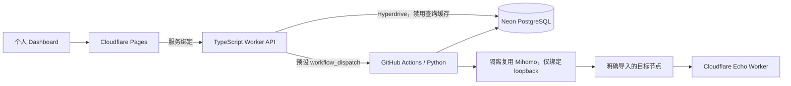
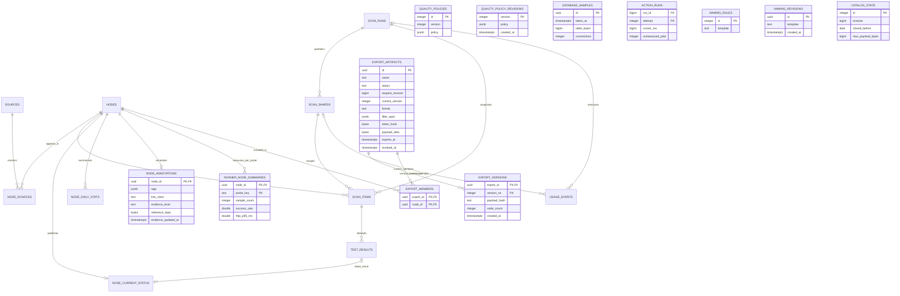

# 完整实现与数据关系

本页描述当前代码实现。免费额度与自有服务器的目标方案见 [ARCHITECTURE_REVIEW.md](ARCHITECTURE_REVIEW.md)；自有服务器不作为当前部署目标。

Worker 负责鉴权、来源/方案 CRUD、状态查询、命名与成品下载。Python Actions 负责抓取订阅、解析标准化、HMAC 去重、检测、订阅转换与条件发布。两端共享 SQL schema、数据库查询/参考分级函数、明文字节存储和 canonical identity 定义；Worker 不需要 HMAC 密钥。FastAPI 是本地调试适配层，不在生产链路中。

## ER

共 22 张业务表；命名规则和导出是独立配置/产物，不与原始配置重复维护身份。初始三表见 M1_DESIGN，后续由 `0002_monitoring` 和 `0003_import_pipeline` 增量迁移。后者在 Source 增加持久化 sync_requested_at，将 scan_date 全局唯一约束改为只对 DAILY 批次生效的部分唯一索引，增加 DAILY/SUPPLEMENTAL 类型约束。`0004_password_protocols` 扩展 Node 协议约束，密码协议的认证保存在已有加密 identity 中；不增加明文密码列，不改旧资产指纹。`0005_usage_observability` 添加用量事件、数据库采样、Action attempt 汇总和单次检测时长/超时阶段。0006 增加四张参考规则/人工资料/Runner 汇总表，以及共用的分页、筛选、命名和分级函数；0007 增加测点隔离退避、执行效率指标与查询索引。0010 增加 CatalogState、ExportMember、ExportVersion，扩展原 ExportArtifact 为固定订阅方案与当前成品；0011 增加扫描归档摘要和关闭日期水位。并发迁移通过按 schema 的事务 advisory lock 串行执行。

查询、等级、抽样和检测执行的完整语义见 [QUALITY_AND_EXECUTION.md](QUALITY_AND_EXECUTION.md)。等级属于人工偏好与有限 Runner 证据的参考，不改变线路真实类型 UNKNOWN。

## 用量口径

用量事件只包含固定种类、状态、内部 ID、时间和数字，不收集 URL、节点配置、原始错误或 job 名称。检测计数包含重试，Echo 包含环境预检；成功订阅下载统计实际返回的应用层字节。检测事件按租约 owner 保存累计快照，重复写入不重复计数。强杀进程会丢失尚未提交的计数；租约过期或被重新领取后，原事件查询为 INTERRUPTED，不发布节点 DOWN。

Linux Job 额外采集默认路由网卡的收发计数差值，覆盖依赖安装等该时段流量；不抓包、不生成测速流量。缺失网卡或计数器重置记为缺失覆盖，不解释为零流量。它不等于云厂商计费流量，也不包含 checkout 之前和计数提交之后的流量。用量统计失败只记录固定错误码，不回滚已完成的导入或检测。

`usage.yml` 只收集同仓库默认分支的指定每日、来源、订阅构建和备份工作流的已完成 attempt；不检出触发运行的代码或读取其 artifact/log。Runner 分钟为 jobs 已知起止时间之和，不是计费分钟；缺失时间的 job 单独计数。工作流收集器自身和普通 CI 不计入此汇总，账户总用量应以提供商后台为准。数据库采样区分整个数据库容量和当前 schema 表/索引容量；历史默认随每日统计保留期清理。

## 不可变资产与来源

Node UUID 对连接身份永久稳定。不同认证产生不同指纹；名称、来源和排序不参与。原始内容归 Source，canonical identity 归 Node，别名列表归 NodeSource；均按用户要求明文保存。用户启停与来源出现状态独立。没有自动删除长期失败资产。

Source revision 防止旧同步覆盖新内容。完整成功才推进 applied_hash 和对账缺失项；部分成功保留旧关联。解析版本变化可强制重解析。节点配置在相同指纹下不可变，因此 scan_items 的 Node UUID 快照可稳定复现配置。

## 导入与任务衔接

Source 保存、输入修改和手动同步会先写入 sync_requested_at，再提交同一条 Actions 流程。调度失败响应保留来源 ID、pending 状态和安全错误码；下一次触发处理全部待同步或到期来源，避免连续导入时丢失请求。同步尝试完成才清除标记，revision 冲突保留新请求。部分解析成功项继续进入检测。

按日 advisory lock 创建不可变快照。每个日历日一份 DAILY，后续只为当天尚未进入任意 ScanItem 的 eligible 节点创建 SUPPLEMENTAL。已有快照、分片和已完成项目不变；未完成批次保留其节点的预约，恢复时不会重新分配。每日统计仍是每节点每天一次最终观测，无跨批次重复计数。计划同时列出保留期内未完成批次和新补测批次，最多 4 个并行 Job；每个批次独立完整发布。

可选 GeoLite 下载在 prepare 完成一次，验证后以 AES-GCM 加密 ZIP 传递到各检测任务。密文 artifact 保留 1 天；明文 MMDB 不上传、不入库、不缓存，安装时只接受两个固定文件名并再次验证数据库。

## 检测与状态

运行支持 Shadowsocks、Trojan、AnyTLS、Hysteria2、VMess 和 VLESS，具体参数与格式范围见 [PROTOCOLS.md](PROTOCOLS.md)。Hysteria2 使用 QUIC，不做入口 TCP 探测。未知且无法证明等价的字段返回 UNSUPPORTED，不能删掉后尝试。GeoIP 只作估计；入口记录为解析/观测 IP，绝不称物理真实服务器。

每个 worker 同时只有一个隔离 Mihomo；切换节点时关闭旧进程和连接，再创建仅包含目标节点的新配置。控制器和 mixed port 仅绑定 127.0.0.1，随机端口和 secret；配置文件 0600，临时目录 0700，日志不输出。此实现以串号安全为先，进程启动开销需实际规模测试。

入口 TCP 是诊断；UP 必须由代理完成小型 HTTPS Echo 且获得有效公网出口 IP。普通失败复测一次才可 DOWN，DNS/Echo/运行时环境错误为 ENVIRONMENT_ERROR。无法可靠测量的握手时间不虚构。

geoip_metadata 保存 City/ASN 数据库版本、各入口解析 IP 的地区/城市/ASN/组织及查询时间，以及出口本地 lookup 的独立证据；Echo 优先的出口 country/ASN 仍在观测顶层字段，不把不一致的本地组织直接归给 Echo ASN。City miss 与 ASN miss 独立处理；缺库/未收录为未知。

ScanItem 主键 `(scan_run_id,node_id)`，结果唯一键 `(scan_run_id,node_id,attempt_no)`。分片由独立用途前缀的 HMAC 稳定分配；租约 owner 和到期时间防止重试 worker 抢写。只有完整批次才更新 current status 和每日统计，finalize 幂等且不会用较老结果覆盖新结果。结果/统计批量 upsert，历史保留到期清理；资产永久保留。

## 安全与 API

当前数据库使用明文 `*_data` 列。HMAC 去重和管理员/订阅鉴权保留；旧 AES 数据通过 0009 一次性转换，备份和 MMDB artifact 的 AES 独立保留，详见 [DATA_STORAGE_AND_LIFETIME.md](DATA_STORAGE_AND_LIFETIME.md)。

API 除 `/api/health` 与高熵 token 订阅外均需管理员 Bearer token。输入、数据库/HTTP 错误不反射敏感原文；日志关闭。Source CRUD 不返回 URL/URI、配置或别名。JSON/CSV 导出只用安全字段白名单，CSV 防公式注入。

主要 API：`/api/overview`、`/api/readiness`、`/api/sources`、`/api/sources/{id}/sync`、`/api/nodes`、`/api/nodes/{id}`、`/api/scans`、`/api/scans/{id}/retry`、`/api/naming-rules`、`/api/exports`、`/subscriptions/{id}?token=...`。Worker 同步接口返回 202，响应中的 dispatched 表示是否成功提交；未提交时为 PENDING 并保留数据库请求。保存来源返回 201 和 pipeline 结果。执行状态由 Python 写入数据库；没有依赖内存的后台任务。readiness 验证数据库版本与调度配置存在，CLI doctor 可再验证 HMAC、核心和直连 Echo。

订阅由 Actions 生成，Worker 只校验并下载当前成品，保存的筛选/排序方案与链接保持稳定。成员资格变动由数据库触发器即时阻断受影响旧文件；数据目录 revision、方案 revision 与构建租约共同防止旧任务覆盖新结果。默认长期链接、可选到期、历史摘要和容量预算见 [ASYNC_SUBSCRIPTIONS.md](ASYNC_SUBSCRIPTIONS.md)。

扫描明细超过保留期归档，活动/近期任务保留可恢复数据，批次摘要与关闭日期水位防止旧日重扫。Node 累计日数不随明细和日统计清理而减少。
