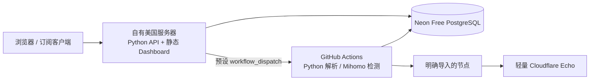

# 架构复核：免费额度与计算平台

日期：2026-11-09。用户约束：已有美国 1 核 / 1GB 服务器，不接受新增托管月费；节点检测继续使用 GitHub Actions，接受免费服务休眠和额度限制。

最新讨论补充了“尽量不用自有服务器、将节点解密与转换也移至 Actions”的偏好。用户现已选择数据库明文存储，当前优先评估 Pages + 轻量 Worker + Actions 预生成明文成品，详见 [ASYNC_SUBSCRIPTIONS.md](ASYNC_SUBSCRIPTIONS.md)；新增/修改订阅的首次生成需要等待后台任务，成品加密/存储也有单独边界。下文自有服务器方案保留为备选，已不作为默认建议。

本文是讨论建议，不代表已经切换生产架构。当前交付仍是 Pages + TypeScript Worker API + PostgreSQL + Python Actions；FastAPI/Docker 仍属于本地适配入口。

## 备选：使用现有服务器

优先复用现有服务器承载一个 Python 业务服务，同时提供 Dashboard、API 和私有订阅；数据库保留 Neon Free，检测继续在 Actions 中运行。Cloudflare 可以继续负责 DNS、TLS/接入和轻量 Echo，无需购买 Workers Paid。前端直接由同一 Python 服务提供，减少跨域、服务绑定和双语言业务维护。

这是低额外成本和代码维护量的折中。服务器仍需系统更新、证书、自动重启和恢复演练，不能称为零维护。单机故障会影响管理和订阅下载；已下载到客户端的节点配置不依赖 Dashboard 常驻。

1 核 / 1GB 作为个人管理和导出服务是合理起点，尚未在该服务器做过内存/并发验收。首版建议单应用进程、少量数据库连接、限制同时导出数；解析大订阅和批量检测留在 Actions。不在这台机器同时部署 Mihomo 批量探测、Redis、多套转换服务和 PostgreSQL。美国地区与接近的 Neon 区域优先实测连接延迟；不据此推断大陆直连体验。

## 为什么不继续依赖免费 Worker 完成大导出

旧版 Worker 同步分页读取数据库、AES 解密、转换并生成完整订阅；0009 已移除数据库 AES，当前仍同步转换格式。已经补上轻量 SQL 投影、每页最多 1,000 条、按密文总字节分批、单快照和最终 10 MiB 上限，但转换本身仍消耗 CPU。

官方当前限制为 Free 每请求 10ms CPU，Paid 默认 30s、可调至 5min；两者都是每 isolate 128MB，且并发请求可能共用同一 isolate。网络等待不计 CPU。见 [Workers limits](https://developers.cloudflare.com/workers/platform/limits/)。因此不能用数据库等待时间或本地测试通过证明满足 Free 限制。

实际 Worker handler + 本地 PostgreSQL 的合成测量中，5,000 节点的创建并下载约 0.65–0.91 秒，15,000 节点原生导出约 4.38–4.84 秒；超过 10 MiB 的 JSON 报告明确拒绝。报告记录的 Node CPU、heap 和 arrayBuffers **不是 Cloudflare CPU 或内存配额验收**。证据：[worker-export-review.json](benchmarks/2026-11-09-worker-export-review.json)。

Actions 预生成订阅现已成为优先方案，当前明文存储允许直接使用 PostgreSQL 成品，无需新增 R2；版本失效、即时停用与撤销仍须实现。Workers Paid 不符合用户不增加月费的选择。

## 免费后端的替代平台

| 方案 | 已核对的限制 | 对本项目的判断 |
| --- | --- | --- |
| 现有服务器 + Neon Free + Actions | 自有服务器 1 核 / 1GB；数据库及 Actions 仍有免费额度 | 当前优先建议；业务只保留一个 Python 核心 |
| Render Free | 无请求 15 分钟休眠，唤醒约 1 分钟；免费 PostgreSQL 30 天到期 | 可做试用，订阅客户端可能等待超时；不使用其限时免费库保存资产 |
| Koyeb Free | 512MB / 0.1 vCPU；1 小时无流量休眠；无持久卷，官方定位为测试和个人项目 | 可以配外部数据库试运行；已有服务器时没有明显收益 |
| Cloud Run 免费额度 | 有请求/计算免费用量，超出另收费；需另核对存储、构建和网络费用 | 按用量计费的免费额度不等于绝不收费，不作为严格零新增费用的首选 |

来源：[Render Free](https://render.com/docs/free)、[Koyeb instances](https://www.koyeb.com/docs/reference/instances)、[Koyeb scale-to-zero](https://www.koyeb.com/docs/run-and-scale/scale-to-zero)、[Cloud Run pricing](https://cloud.google.com/run/pricing)。上述是平台比较；当前仓库没有实现这些平台的生产适配。

Neon 当前 Free 提供每项目 1GB 存储、每月 100 CU-hours、5GB 公网传输；无活动 5 分钟休眠。具体以账户控制台和 [Neon plans](https://neon.com/docs/introduction/plans) 为准。1GB 不能直接承诺容纳任意规模的多年检测历史。当前明细/统计清理已存在，但扫描快照长期累计、备份占用和 PostgreSQL 膨胀仍需纳入容量策略；迁移前应测量按天增量并设定有界保留规则。Dashboard 关闭或隐藏后不应持续轮询使数据库无法休眠。

GitHub Actions 保留自动和手动入口，但 schedule 可能延迟；公共仓库长期无活动会自动停用定时工作流。这是“长期不用照看”的实际边界，需要在界面提示最后成功时间和任务异常，不能靠日程存在就认为每天已经执行。见 [GitHub schedule](https://docs.github.com/en/actions/reference/workflows-and-actions/events-that-trigger-workflows#schedule)、[停用工作流](https://docs.github.com/en/actions/how-tos/manage-workflow-runs/disable-and-enable-workflows)。代码与合成 fixtures 可以公开，真实节点、订阅地址、数据库、密钥和明文 artifacts 不入 Git。

## 上游源码复核

本次再次读取固定提交的源码，而非只比较 README。现有解析参考详情见 [PARSER_REFERENCES.md](PARSER_REFERENCES.md)。

| 项目 / 固定提交 | 实际对照部分 | 值得采用的方式与边界 |
| --- | --- | --- |
| Sub-Store / `2888806251d90d45eabf2baf7a7fd4e8be2a4787` | `proxy-utils/parsers`、`utils/download.js`、`utils/request-concurrency.js` | 兼容格式映射、包含 UA/请求头的缓存键、请求排队与 finally 释放、内容校验后写缓存。其请求合并分支与运行环境有关，不能直接宣称 Node 模式所有请求都 single-flight。脚本处理器、任意本地路径和 URL 日志不照搬 |
| subconverter / `a0d4eab28cb8b6c782d4ce5c3a918de4829b4a72` | `parser/subparser.cpp`、`handler/webget.cpp` | 解析适配器和标准化结构可参考。该提交抓取公共选项关闭 TLS 证书校验并允许较多重定向，不沿用本项目；某些构造默认值也不能直接用于资产身份/HMAC |
| beck-8/subs-check / `3c320fd58aff5235e16218c050ec5b8ce587e233` | `check/check.go` 的并发流水线、取消和统计 | 借鉴分阶段有界并发和超时取消；其测速/媒体解锁不在本项目范围。本次没有将它误列为已验证的 Actions 定时测活项目 |
| V2RayAggregator / `ff3913ddade73025d642c4a5baf004b770ee2a85` | `.github/workflows/Collector.yml`、`speedtest_yml.yml` | 实际有 schedule / workflow_dispatch；但包含下载测速、提交节点到 Git、旧 Action 和浮动引用。本项目只参考定时组织方式，不复制这些数据流和依赖选型 |

源码：[Sub-Store download](https://github.com/sub-store-org/Sub-Store/blob/2888806251d90d45eabf2baf7a7fd4e8be2a4787/backend/src/utils/download.js)、[并发队列](https://github.com/sub-store-org/Sub-Store/blob/2888806251d90d45eabf2baf7a7fd4e8be2a4787/backend/src/utils/request-concurrency.js)、[subconverter parser](https://github.com/tindy2013/subconverter/blob/a0d4eab28cb8b6c782d4ce5c3a918de4829b4a72/src/parser/subparser.cpp)、[subconverter webget](https://github.com/tindy2013/subconverter/blob/a0d4eab28cb8b6c782d4ce5c3a918de4829b4a72/src/handler/webget.cpp)、[subs-check pipeline](https://github.com/beck-8/subs-check/blob/3c320fd58aff5235e16218c050ec5b8ce587e233/check/check.go)、[Aggregator workflow](https://github.com/mahdibland/V2RayAggregator/blob/ff3913ddade73025d642c4a5baf004b770ee2a85/.github/workflows/Collector.yml)。

解析器参考行为后使用脱敏 fixtures 验证，保留单一 canonical Node 模型与现有 AES/HMAC 身份。Sub-Store 为 AGPL-3.0，subconverter 为 GPL-3.0；若后续复制源码，应明确记录来源、版本和适用许可。当前没有新增这些项目的生产运行时或复制其源码进入发行内容。

## 切换前必须完成的代码工作

当前 FastAPI 不能直接替代 Worker 上线。迁移需先落实以下差异，再交付服务器部署包：

1. 来源保存/更新后写入同步队列，异步触发固定 Actions；API 请求不直接抓取大订阅，调度失败可恢复。
2. 统一生产 API 的错误、readiness、鉴权、导出和页面交互契约；减少 TypeScript/Python 两套业务实现。
3. Python 导出改为有界分页、字节限制和受控并发；当前 Python 仍会在输出前累计对象，不能因 Worker 已优化就认为服务器路径已同等优化。
4. 单应用进程、容器资源/自动重启、连接池、无敏感请求日志、健康检查、TLS、加密备份/恢复和回滚；定时解析/检测仍在 Actions。
5. 有界扫描历史/容量告警与免费数据库休眠兼容；用合成规模和真实服务器 RSS 验证，再用小批授权节点验收完整云端链路。

这些是建议方案的待实施工作，不是已完成的生产能力。无需为此重写 Go；网络核心已经使用 Go 实现的 Mihomo，主要优化点是减少业务重复、数据库传输和不受控内存分配。
