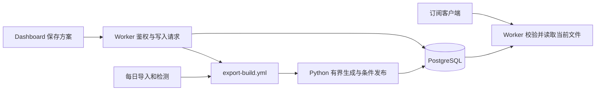

# Actions 生成订阅与固定链接

当前实现：Cloudflare Pages → TypeScript Worker → PostgreSQL，Python GitHub Actions 负责拉取、解析、检测和订阅转换。不需要常驻 Python 服务、R2 或 Redis。FastAPI 只供本地调试。



## 使用与状态

保存格式、筛选、排序与最多节点数后，API 返回 **202**，并给出固定链接与调度结果。首次生成、资格失效或修改筛选时，下载返回 **503 / EXPORT_PENDING / Retry-After: 60**，不是空成功文件。Actions 排队与启动需要时间。

页面显示等待生成、生成中、等待更新、就绪、失败、过期、撤销，以及最后成功版本、节点数、时间与错误码。支持编辑方案、重新生成、查看链接、版本摘要、撤销和更换密钥。后台只刷新列表，不覆盖正在编辑的表单或已显示的链接。

新链接默认长期有效，直到撤销；也可指定 `expires_in_hours`，范围 1–8760。旧版本链接保留原到期时间及 token hash。普通列表/详情不返回凭据；管理员可用 `/link` 恢复新方案的地址。旧 hash 无法恢复原 token，原链接仍可用；只有主动更换密钥才使旧 token 失效。

每次客户端下载都不触发 Actions。创建、编辑、重试会尝试提交 `export-build.yml`，失败仍保留数据库请求。每日流水线在来源同步后、扫描发布后各处理一次待生成方案；独立生成工作流不必等待整轮健康检测。

## 发布与失效

- 一个方案保存一个当前成品，`export_versions` 仅保留历史摘要，不存多份旧正文；`export_members` 记录当前成品成员。
- Python 在同一个只读 REPEATABLE READ 快照里分页筛选和转换，单页最多 1,000 节点，配置读取按约 1 MiB 分批，正文生成期间限制为 10 MiB。
- 构建有 5 分钟租约和分页续租；过期任务可恢复。发布时校验 owner、方案 revision、数据目录 revision 和有效时间，旧任务不能覆盖新方案。每次任务每个方案最多尝试一次，避免持续变化时忙循环。
- 节点停用、配置改变、当前健康资格变动、有效来源或成员关系失效，会在同一数据库事务中阻断受影响旧文件。命名与参考规则修改会阻断旧文件并要求更新。下载即时检查撤销、token、期限和版本资格；ETag 不能绕过这些检查。
- 新资产加入、无关资产变化、单纯更新来源发现时间等不使已有成员失效时，旧文件可以继续使用，列表显示待更新；无关构建失败也可保留仍有效的旧文件。
- 当前文件的有效期限为成员最近成功时间加检测新鲜度中的最早值，避免暂停检测后一直下发旧配置。空文件也有有效期。报告内容是生成时的快照，日期和统计下次构建更新；节点列表的已收录天数仍在查询时动态计算。
- Worker 下载只读取鉴权元数据和现成文件，不读取节点配置或调用转换器。已生成内容是 UTF-8 文本，PostgreSQL 在传输时转为 text，避免 bytea 的十六进制膨胀；文件大小在数据库和接收端均校验。成功正文下载另写一条可选数值用量事件，304 不计正文流量。

已下载到客户端的副本无法远程撤回。

## 应用存储预算

默认最多 **20 个有效方案、64 MiB 当前文件总量、100,000 条成品成员、每方案 20 条历史摘要**。单个成品上限 10 MiB。创建时和构建前清理过期/撤销方案；发布事务使用共享预算锁，容量不足明确失败，不覆盖上一份文件。这些是应用预算，不是提供商免费额度。

```bash
uv run nodema export create --format mihomo --name my-subscription
uv run nodema export build-pending
uv run nodema export list
uv run nodema export retry <EXPORT_ID>
uv run nodema export budgets
# 可选缩小预算；不得低于已有使用量
uv run nodema export budgets --max-profiles 10 --max-payload-bytes 33554432
```

CLI 创建默认只入队；本地希望马上生成时加 `--build-now`。配置格式的文件与订阅链接均应按凭据保管，勿写入 Git 或公开日志。数据库按用户选择明文存储，备份仍加密。

## 扫描明细归档

`nodema cleanup` 按 `DETAIL_RETENTION_DAYS`（默认 60）清理旧结果、扫描成员和分片，批次保留轻量摘要。活动租约、近期结果和被其他事务锁定的批次会保留；未完成活动批次的旧成功项也保留，确保恢复后可以完整发布。用量记录保留数值并解除对已删除分片的引用。

已归档日期通过持久化关闭水位防止重新生成快照和重复计数，归档批次不能重跑。页面可查看原计划数量与结果摘要。每日统计默认保留 365 天；清理不减掉 Node 的累计已检测/可用天数，不删除资产。轻量批次摘要长期保留，因此这里限制的是随节点数增长的明细，不承诺数据库永不增长。

`0011` 已归档后不能直接降级恢复被删明细，必须使用归档前备份。新版本迁移 head 为 `0011_scan_archives`。

## PostgreSQL 迁移

Python 使用 SQLAlchemy/psycopg，Worker 使用 pg/Hyperdrive，没有 Neon 专有数据 SDK。可迁到其他完整 PostgreSQL 或自建 PostgreSQL：暂停写入，使用直连地址备份、恢复 schema/函数/数据/索引，保留 HMAC 和资产 ID，更新 Actions 与 Hyperdrive 连接源并保持禁用查询缓存，验证后恢复任务。SQLite、D1、MySQL 需要改写 PostgreSQL 类型、函数和锁，不能只换连接串。

已有真实本地加密备份/恢复测试；不等于已完成跨云迁移。参考 [PostgreSQL SQL dump](https://www.postgresql.org/docs/current/backup-dump.html) 与 [Neon 导出说明](https://neon.com/docs/import/migrate-from-neon)。本地性能不证明 Cloudflare Free CPU、Neon 额度或 GitHub 实际调度通过，仍需在用户环境验收。
