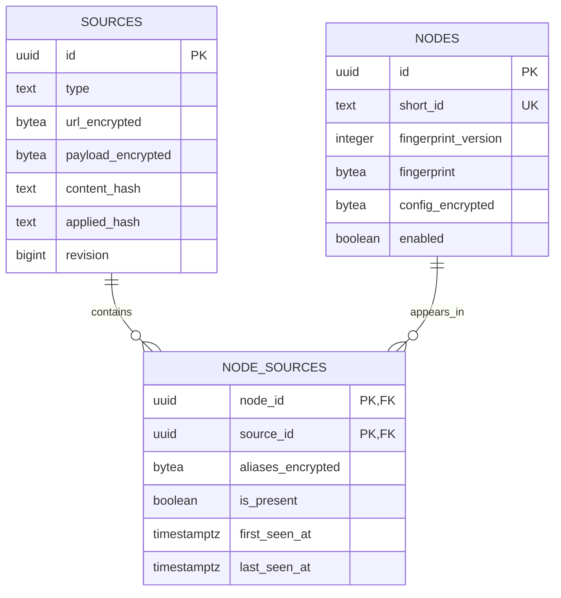

# M1 最终设计

本文为最初 M1 范围的历史设计记录。当前完整实现和增量迁移见 [ARCHITECTURE.md](ARCHITECTURE.md)，全量状态见 [STATUS.md](STATUS.md)。

## 需求理解与风险

面向个人维护的资产库，采用单个 Python 项目和 PostgreSQL。运行环境与业务逻辑分离，可在本地或未来临时 Runner 执行。只实现 M1，不提前加入调度、运行时检测或 Web 服务。

核心风险是跨格式参数语义、敏感输入泄漏、订阅 SSRF、部分失败导致误删除，以及并发导入。对应措施为保守的版本化 canonical identity、应用层加密、安全错误码、连接时地址校验、完整快照对账和数据库事务/唯一约束。

## ER 与字段职责



- Source：非敏感管理标签、输入类型/格式、加密 URL 和最新原文、启停、周期元数据、观察/应用 Hash、解析器版本、检查/完整同步时间、安全错误摘要、revision 和软删除时间。
- Node：永久 UUID、sequence 分配的 `N{number:06d}` 编号、版本化 HMAC、协议和基础端点元数据、加密 canonical identity、人工启停、首次/最近出现时间。
- NodeSource：一对资产/来源一条关联；所有原始别名作为加密列表保存，保留首次/最近出现和当前是否存在。
- `UNIQUE(fingerprint_version,fingerprint)`，指纹为 32 字节；端口范围 1～65535。外键 RESTRICT，删除来源不破坏资产历史。
- Observation 属于后续里程碑；M1 无观测表、健康状态或运行支持结论。

相对初始规范的有意简化：取消 `source_item_key` 和逐出现记录；原始名称只归来源关联；取消关联层的原文副本；统一名称实时计算；解析失败归 Source 报告，不为全部合法资产持久化常量解析状态。没有凭来源名字判断物理服务器身份的逻辑。

## 数据流与接口

```text
Source encrypted input
  → fetch/decrypt outside write transaction
  → SHA-256 + parser version check
  → parser adapters → NormalizedNode
  → canonical JSON → HMAC
  → short write transaction: revision check + node upsert + association reconcile
```

Python 入口：

```python
from app.parsers import (
    parse_vless,
    parse_vmess,
    parse_clash_yaml,
    parse_singbox_json,
    parse_document,
)
from app.ingestion.service import AssetService
from app.security.crypto import Cipher, fingerprint
```

- `parse_vless(uri: str) -> NormalizedNode`
- `parse_vmess(uri: str) -> NormalizedNode`
- `parse_clash_yaml(payload: bytes, *, max_items=10000) -> ParseReport`
- `parse_singbox_json(payload: bytes, *, max_items=10000) -> ParseReport`
- `parse_document(payload: bytes, format_hint=InputFormat.AUTO, *, max_bytes, max_items)`
- `AssetService.create_source / get_source / list_sources / update_source / delete_source`
- `AssetService.sync_source(source_id, *, force=False)` 返回 SUCCESS、PARTIAL、FAILED 或 UNCHANGED。
- `AssetService.list_nodes / get_node / set_node_enabled / preview_names`

`ParseReport.nodes` 为内部敏感对象，`summary()` 仅包含数量和固定错误码/记录序号。不支持的资产协议使报告不完整；明确的非资产项可忽略。每个适配器正确区分传输、TLS 安全层、VMess cipher 及 sing-box 的 allowed network。

canonical JSON 使用 UTF-8、排序后的对象键、紧凑分隔符、不允许 NaN。名字、来源和导入顺序不参与连接身份；未知字段保留其原格式命名空间。缺失、空字符串、显式值与有序列表不随意合并。默认值策略是保守去重，接受少量未合并资产以避免合并不同凭据/行为。

HMAC 输入为 `b"nodema:identity:v1\0" + canonical_json(identity)`。密文格式为 magic `NMA1`、key ID 长度、key ID、12 字节 nonce 和完整 ciphertext/tag；header 与表/记录/字段上下文共同作为 AAD。冲突 upsert 只刷新 Node 出现时间，保留原密文及其 UUID 绑定。所有同批资产按指纹排序写入，以降低跨来源并发时的锁冲突。每 250 条批量分配编号、upsert Node 和关联；仍在同一事务中提交，避免逐节点远程数据库往返。同步报告区分新建和复用数量。

## 项目与依赖

`app/domain.py` 定义内部结构和安全错误；`app/parsers/core.py` 集中纯适配器；`app/ingestion` 负责 HTTPS 获取及同步；`app/database` 为 SQLAlchemy 模型与 Session；`app/security` 为加密和日志策略；`app/naming.py` 为纯命名函数；`app/cli.py` 为薄命令层。

Python 3.12；SQLAlchemy 2.x 同步 API、Alembic、psycopg 3、cryptography、PyYAML、pydantic-settings、Typer。获取层直接使用 HTTPCore 的公开 network backend，避免额外 HTTPX transport 适配层；dnspython 提供有界 DNS。实际锁定版本见 `uv.lock`。

参考原项目定义：[VMess 分享格式](https://github.com/2dust/v2rayn/wiki/Description-of-VMess-share-link)、[VLESS 分享提案](https://github.com/XTLS/Xray-core/discussions/716)、[Mihomo](https://wiki.metacubex.one/en/config/proxies/)、[sing-box](https://sing-box.sagernet.org/configuration/outbound/)、[HTTPCore](https://www.encode.io/httpcore/network-backends/)、[AES-GCM](https://cryptography.io/en/stable/hazmat/primitives/aead/)。

## 验收

测试覆盖合成四格式与 100 节点输入、跨来源/跨格式去重、认证差异、稳定 UUID、加密/篡改/AAD、日志和普通 SQL 查询泄漏、SSRF/重定向/DNS 固定、内容不变跳过、部分失败、空快照、来源停用/软删除、人工禁用、并发写入和事务中断。真实 PostgreSQL 上检查迁移往返、sequence 清理及模型差异；缺少测试数据库会失败。M1 不接受真实节点作为版本库 fixture。

2026-11-07 本地验证：Python 3.12.11、SQLAlchemy 2.1.8、Alembic 1.20.1、PostgreSQL 17.6。77 项测试通过，应用代码覆盖率 87%；Ruff 检查、格式检查、依赖锁文件检查和 Compose 配置校验通过。CLI 子进程测试验证三种格式复用同一 Node、标准输入、CRUD、启停和退出码；400 条合成资产测试验证跨 250 条批次写入，数据库往返小于 30 次。没有连接真实节点或真实订阅，也没有对运行时间或云端费用作保证。
